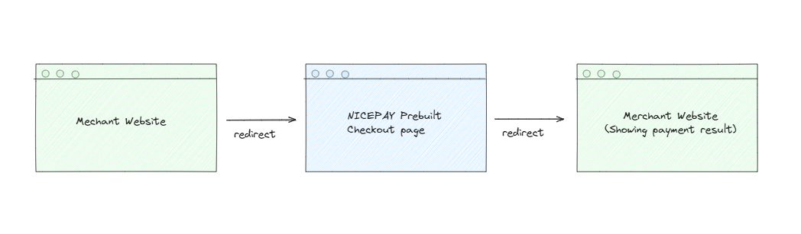

# NICEPAY Shop

NICEPAY Shop is a demo Next.js storefront that shows how to integrate a web app with NICEPAY's prebuilt hosted checkout page. Browse products, manage a cart, and complete a payment. All without building a custom payment UI.

## High-level Flow



1. Shopper adds items to cart (stored in a signed HTTP-only cookie).
2. On checkout, the server calls NICEPAY's **Registration API** and receives a `paymentURL`.
3. Shopper is redirected to NICEPAY's hosted checkout page and completes payment there.
4. NICEPAY redirects the shopper back to `/checkout-return`, which forwards query params to `/result`.
5. NICEPAY sends an asynchronous **webhook** (`POST /api/webhook`) to confirm the transaction.
6. The result page calls NICEPAY's **Inquiry Status API** to verify and display the outcome.

> We store the cart data in the cookie for the sake of simplicity. In a real production setting, you may want to store the cart data in a more persistent database and keep only the ID in the cookie (or handle it however suits you best).

## Getting Started

### Prerequisites

- Node.js 20+
- A NICEPAY merchant account (iMID + merchant key) or you can just use our testing iMID and its merchant key.

### Environment Variables

Create a `.env.local` file in the project root:

```env
# Your store's public URL (used for webhook and the redirect page)
STORE_URL=http://localhost:3000

# NICEPAY credentials
NICEPAY_IMID=your_merchant_imid
NICEPAY_MERCHANT_KEY=your_merchant_key
NICEPAY_BASE_URL=https://dev.nicepay.co.id
```

### Running Locally

```bash
npm install
npm run dev
```

Open [http://localhost:3000](http://localhost:3000) in your browser.

> **Webhook note:** NICEPAY cannot reach `localhost`. Use a tunnel (e.g. [ngrok](https://ngrok.com) or [CLoudflared Tunnel](https://developers.cloudflare.com/tunnel/)) and set `STORE_URL` to the tunnel URL so the webhook (notification) works end-to-end in your local development setup.

## Project Structure

```text
.
├── app/                            # Next.js App Router
│   ├── layout.tsx                  # Root layout (fonts, global providers)
│   ├── globals.css                 # Global Tailwind CSS entry point
│   ├── page.tsx                    # Product catalog page (/)
│   ├── actions.ts                  # Server action: add item to cart
│   │
│   ├── cart/
│   │   ├── page.tsx                # Cart & checkout summary page (/cart)
│   │   └── actions.ts              # Server actions: update quantity, initiate checkout
│   │
│   ├── checkout-return/
│   │   └── route.ts                # Route handler: bridges NICEPAY redirect back to /result
│   │
│   ├── result/
│   │   └── page.tsx                # Payment result page — verifies status via NICEPAY API
│   │
│   └── api/
│       └── webhook/
│           └── route.ts            # Webhook endpoint: receives async NICEPAY notifications
│
├── components/
│   ├── global/
│   │   ├── header.tsx              # Sitewide header with cart item count
│   │   └── footer.tsx              # Sitewide footer
│   └── ui/
│       ├── add-to-cart-form.tsx    # Per-product add-to-cart form (client component)
│       └── checkout-form.tsx       # Checkout button with error state (client component)
│
├── config/
│   └── config.ts                   # Resolves STORE_URL into callBackUrl / dbProcessUrl
│
├── lib/
│   ├── cart.ts                     # Cart read/write helpers (signed cookie, HMAC)
│   ├── gateway.ts                  # NICEPAY API client (registration + status inquiry)
│   ├── payload.ts                  # Builds the JSON payload for NICEPAY registration
│   ├── types.ts                    # Shared TypeScript types and interfaces
│   ├── utils.ts                    # Utility functions
│   └── data/
│       ├── customer.ts             # Hardcoded demo customer used in checkout payload
│       ├── payment-method.ts       # Payment method status map used in checkout payload
│       ├── products.ts             # Demo product catalog (name, price, images)
│       └── sellers.ts              # Demo seller/merchant info
│
├── public/                         # Static product images
│   ├── cap/
│   ├── keychain/
│   ├── plushie/
│   ├── shirt/
│   └── tote-bag/
│
├── docs/
│   └── high-level-flow.png         # Payment flow diagram
│
├── next.config.ts                  # Next.js configuration
├── tsconfig.json                   # TypeScript configuration
└── eslint.config.mjs               # ESLint configuration
```

## Key Modules

### `lib/gateway.ts`
Handles all communication with NICEPAY:
- `registerNicepayTransaction(lines)` — POSTs to `/redirect/v2/registration` and returns the hosted checkout URL.
- `getTransactionStatus(...)` — POSTs to `/direct/v2/inquiry` to fetch the final transaction state.

### `lib/cart.ts`
Manages the shopping cart stored in an HTTP-only, HMAC-signed cookie. Prevents client-side tampering without requiring a database.

### `lib/payload.ts`
Constructs the exact JSON structure required by NICEPAY's registration endpoint, including line items, customer details, and callback URLs.

### `app/checkout-return/route.ts`
NICEPAY redirects the shopper here after payment. The route transparently forwards all query parameters (or form-encoded POST body) to `/result` so the result page can verify the transaction.

### `app/api/webhook/route.ts`
Receives the asynchronous `POST` notification from NICEPAY confirming payment completion. Extend this handler to update your database or trigger fulfillment.

## FAQ
### Why call the Inquiry Status API on the result page?
Because query parameters should not be trusted as the source of truth. To determine and display the correct payment status to users, your application should call the NICEPAY Inquiry Status API and use the response returned by NICEPAY.

### Why I didn't receive the notification/webhook callback?
Security services, CDNs, or firewalls (such as Cloudflare) may block notification (webhook) requests sent by NICEPAY to your server. Please check your configuration and ensure that NICEPAY's requests are allowed.

If the issue persists, do not hesitate to contact our Integration Team for assistance. We will be happy to help you.

### Why choosing Next.js for the demo?
We chose Next.js for this demo for two primary reasons:

1.  **It is a full-stack framework.** Next.js allows us to build both the client-side user interface and the server-side logic (e.g., webhook API) within a single project. This makes it significantly easier to demonstrate the complete, end-to-end flow of a web application (from the user's first click to the final server-to-server webhook notification) without the complexity of managing separate frontend and backend codebases.

2.  **It is one of the most popular and widely adopted web frameworks.** According to the Stack Overflow Developer Survey of 2025, Next.js is one of the most used web frameworks by professional developers.

    > Stack Overflow. (2025). *2025 Developer Survey*. [https://survey.stackoverflow.co/2025/](https://survey.stackoverflow.co/2025/technology#1-web-frameworks-and-technologies)

3.  **It is a primary target for AI-native development.** The modern software development landscape is increasingly influenced by AI and Large Language Models (LLMs) for code generation. Many Leading AI code generation platforms and agentic coding frameworks often default to or provide first-class support for Next.js.


### Do not hestitate to ask our integration team for help!